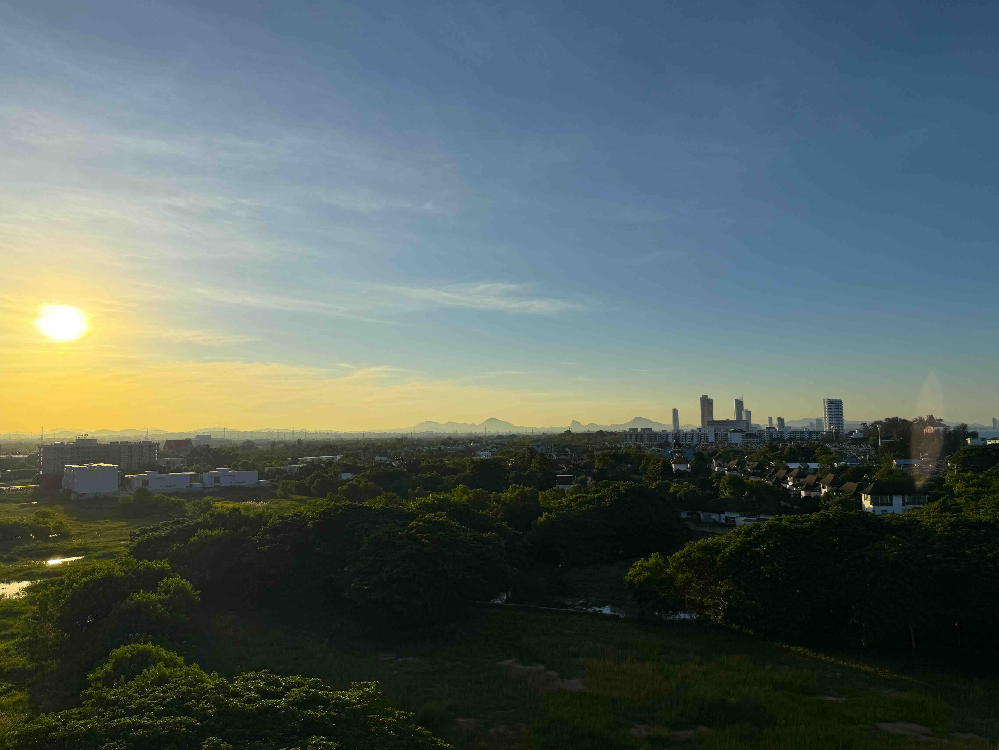
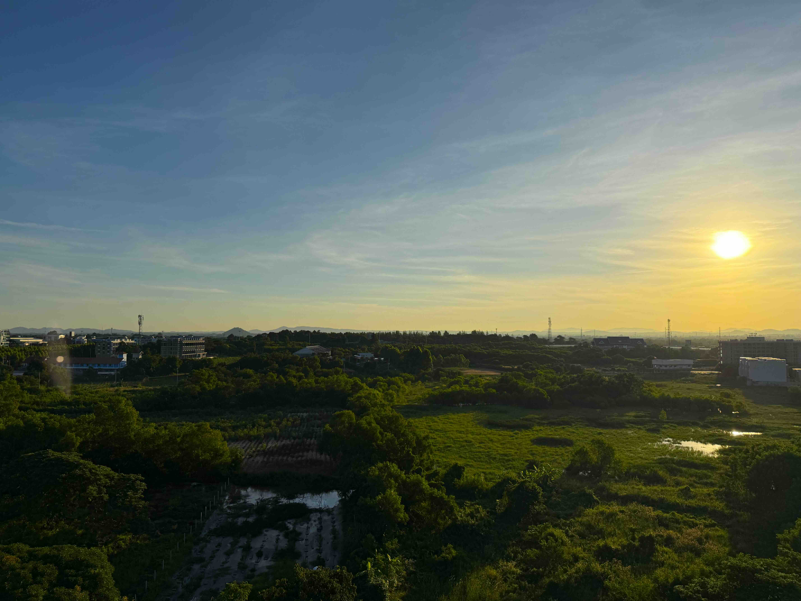
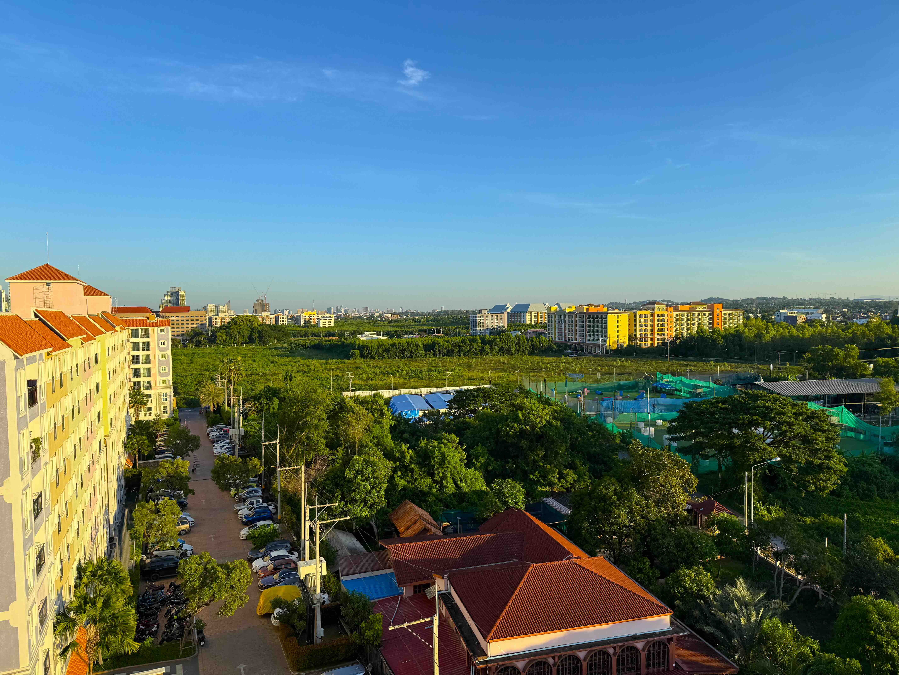
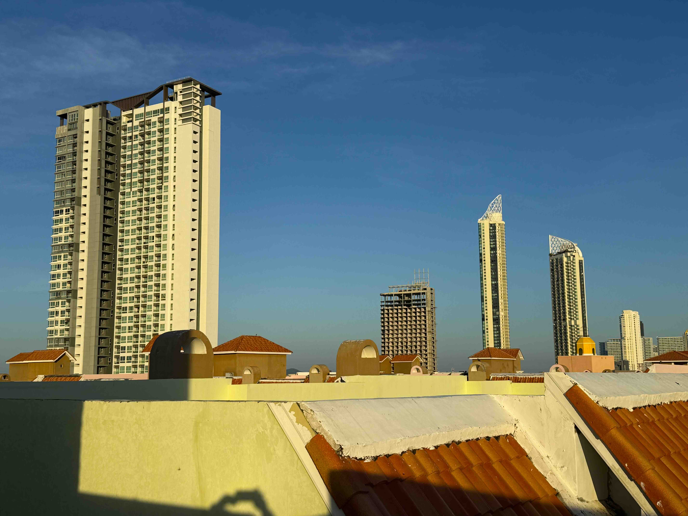
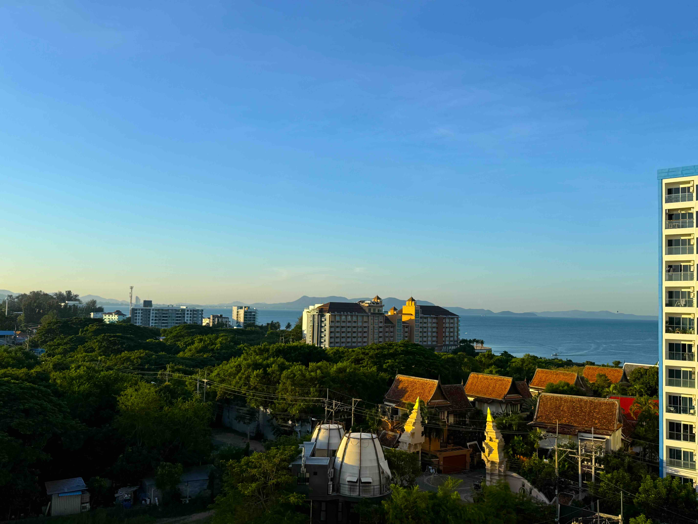
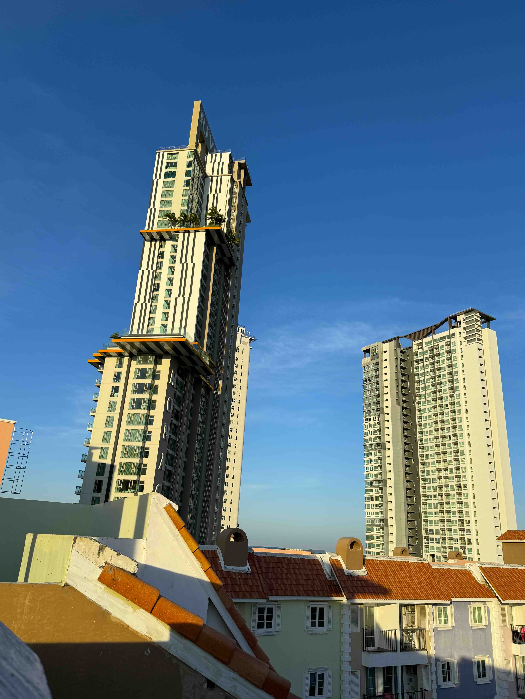
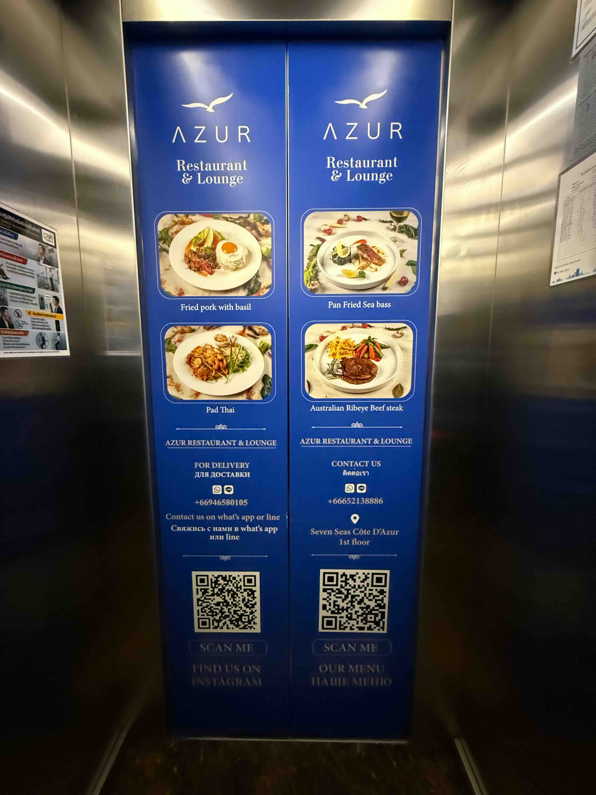
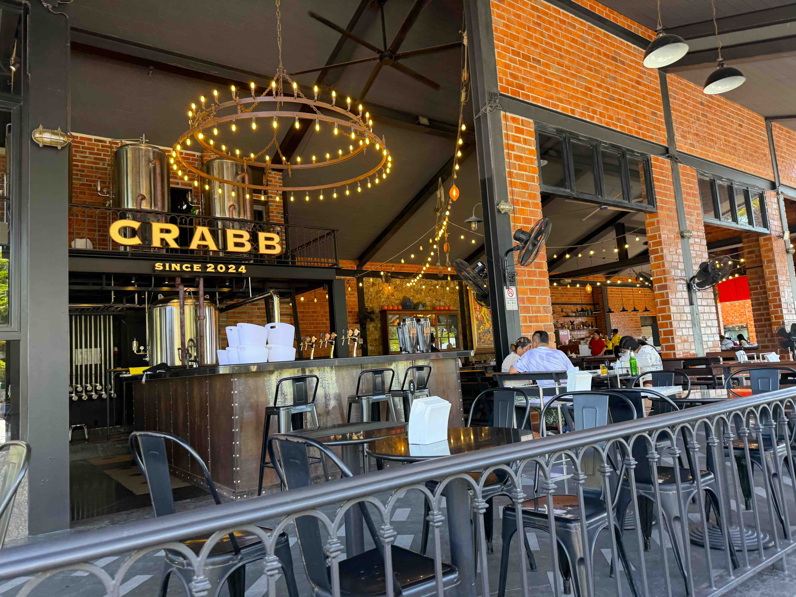

# 20261122_bangkok

<html lang="ja" data-loaded="false" data-scrolled="false" data-spmenu="closed">
<head>

<meta charset="UTF-8">
<meta http-equiv="Content-Type" content="text/html; charset=UTF-8">
<meta http-equiv="X-UA-Compatible" content="IE=EmulateIE10" />
<meta http-equiv="X-UA-Compatible" content="IE=edge">

<meta name="viewport" content="width=device-width, initial-scale=1.0">

<!--ここから上はお決まりの定型文です-->

<!--ここからが表現の書式などを決めるcssという部分-->

<link href="https://cdnjs.cloudflare.com/ajax/libs/lightbox2/2.7.1/css/lightbox.css" rel="stylesheet">

</head>

<body>
    
<!--
    
<a href="https://peyng.github.io/restart/">前回までの記録</a>><a>今回2026,05,28</a>

-->

モバイル端末をお使いの場合は、画面を横向きにすると
背景画像の横方向がご覧頂けます。

<!--ここ上は、ほぼそのまま使います！-->

<!--QRコードの挿入例-->

 QR for Access

<marquee direction="left" scrollamount="20" width="30%">(^_^)/~alis</marquee>

<!--流れ文字の挿入例-->
<h1><marquee behavior="left">!!! 2026/11/22、パタやーの朝から、お昼のレストランとバンコクへのバス移動まで  !!!</marquee></h1>

<!--ここから下が、本体部分-->

<h2>2026/Nov/21日、宿泊したマンションの屋上から、朝のパタヤーの日の出</h2>

<h2>街の向こうに広がる海はタイランド湾</h2>

<h2>お隣の高層ビル群も朝陽を浴びてます</h2>

<h2>エレベータの扉にはレストランの広告</h2>

<h2>プールで泳ぐ白人さんの泳ぎがかなり特徴的、手で水面を叩く音がこの人ならでは</h2>

<iframe width="560" height="315" src="https://www.youtube.com/embed/sDEJp33RixQ?si=dL0iSjr6m8eQ1Snh&autoplay=1&mute=1&loop=1&playlist=sDEJp33RixQ" title="YouTube video player" frameborder="0" allow="accelerometer; autoplay; clipboard-write; encrypted-media; gyroscope; picture-in-picture" allowfullscreen></iframe>
    

<h2>昨日のレストランでお昼、大きい店で違う席に座ると別の店のよう</h2>

<h2>車で行くと日よけのカバーを掛けてくれます</h2>

<h2>建設中の高層マンション、まだ骨組みだけです</h2>

<h2>この日のお昼もまずはチャーハン</h2>

<h2>観光バスが来るような大きなレストランでした</h2>

<h2>カバー掛けのおじさん、暑さに負けずにお仕事中</h2>

<h2>今回は食べ過ぎないようにして、3人で1,032バーツ、約5,000円弱</h2>

<h2>真っ黒になって働くカバー掛けのおじさんに、チップ20バーツあげました</h2>

<h2>仏壇は屋外にあるとは思えないほど、綺麗に祀られてます</h2>

<h2>パタヤーの海沿いに展望レストランが見えます</h2>

<h2>バスでバンコクに移動します</h2>

<h2>ほぼ中間地点の山々も綺麗に見えてます</h2>

<h2>バスでの移動だと、タクシーの1/10程度の費用で済みます</h2>

<h2>バンコクに近づくと建物が増えてきます</h2>

<h2>西の空には天使の梯子</h2>

<h2>スワンナプーム国際空港の管制塔が見えてきました</h2>

<h2>空港に到着</h2>

<h2>管制塔の向こうを旅客機が飛行</h2>

<h2>空港ロビー内の鬼さん</h2>

<h2>王室の喪中オブジェもかなり立派です</h2>

<h2>青鬼さんも居ました</h2>

<h2>スワンナプーム国際空港の警備員さん、歩きません</h2>

<iframe width="560" height="315" src="https://www.youtube.com/embed/XIPa24SXqrg?si=5xvOz-zLjogw11bU&autoplay=1&mute=1&loop=1&playlist=XIPa24SXqrg" title="YouTube video player" frameborder="0" allow="accelerometer; autoplay; clipboard-write; encrypted-media; gyroscope; picture-in-picture" allowfullscreen></iframe>
    

<h2>成田行きのチェックイン待ちの列、日本人に見える人たちはパスポートの色が違いました</h2>

<h2>知人の送迎が終わって、アプリでタクシーを呼びます</h2>

<h2>今ここにいるから、ちょっと待ってね！と地図と運転手さんの顔写真、車のNoが通知されます</h2>

<h2>一般道がフリーウェイの下をくぐるトンネル、初めて通るとかなりビックリ、潜ったあとの右折シーンで後ろの一般車に抜かれちゃいました</h2>

<iframe width="560" height="315" src="https://www.youtube.com/embed/BzBSJBLa5LE?si=AJ-bw0ga_vCV8Fhe&autoplay=1&mute=1&loop=1&playlist=BzBSJBLa5LE" title="YouTube video player" frameborder="0" allow="accelerometer; autoplay; clipboard-write; encrypted-media; gyroscope; picture-in-picture" allowfullscreen></iframe>
    

<!--
<h2>カラオケの盛り上がりは絶好調</h2>

<iframe width="560" height="315" src="https://www.youtube.com/embed/ppqZmsheMTw?si=9aRPlRBRy2xuQZRI&autoplay=1&mute=1&loop=1&playlist=ppqZmsheMTw" title="YouTube video player" frameborder="0" allow="accelerometer; autoplay; clipboard-write; encrypted-media; gyroscope; picture-in-picture" allowfullscreen></iframe>
    

<h2>Moon age</h2>
    <h2>
<a href="https://starwalk.space/ja/moon-calendar" target="_blank">Moon age Link</a>
</h2>
-->

<h2>今日のBGMは、Bee Gees, Air Supply, Phil Collins, Lobo,...Classic Love Songs 70s-90s ❤️ Best Soft Rock Oldies 90s</h2>

<iframe width="560" height="315" src="https://www.youtube.com/embed/HrpoJsr7iGg?si=AeyNmhL5-OX_2hHo" title="YouTube video player" frameborder="0" allow="accelerometer; autoplay; clipboard-write; encrypted-media; gyroscope; picture-in-picture; web-share" referrerpolicy="strict-origin-when-cross-origin" allowfullscreen></iframe>
    

   
<h2>2026Nov22、パタやーの朝から、お昼のレストランとバンコクへのバス移動まででした Thank you for reading this far.</h2>
<!--
     
<h2>
<a href="https://torokoid.github.io/Mashiko_himawari_3/" target="_blank">クリックでメニューページに戻ります</a>
</h2>
-->

   

<!-- hitwebcounter Code START -->
<a href="https://www.hitwebcounter.com" target="_blank">

you are visitor The numbers are cumulative for the Bangkok ＆ Utsunomiya series websites launched since 2025 August 1st.
</a>   

<!--本体はここまで-->
    

<!--画面に空白地帯を作って、背景が見えるようにしています-->

<!-- フッタ -->
<footer>

Copyright 2026/11/22 alis

</footer>

<!--HPにさまざまなJavaScriptを呼び込むための書式-->

    
    </body>
    
</html>
